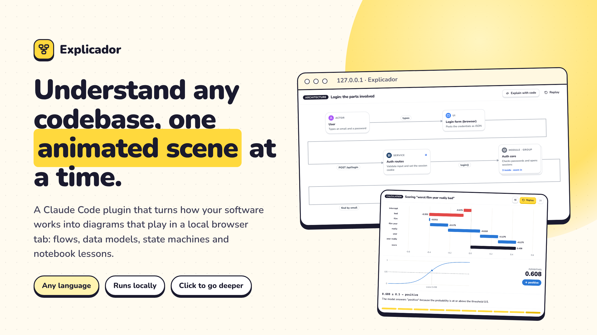
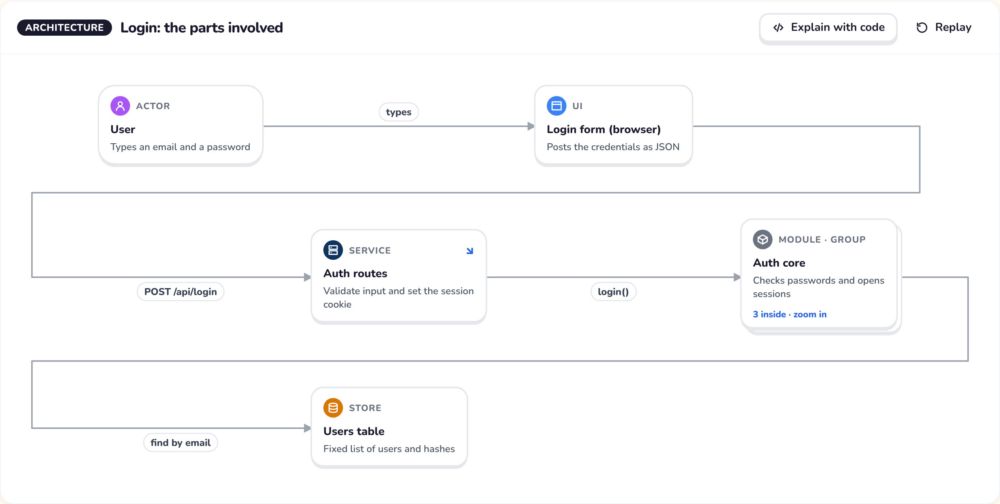
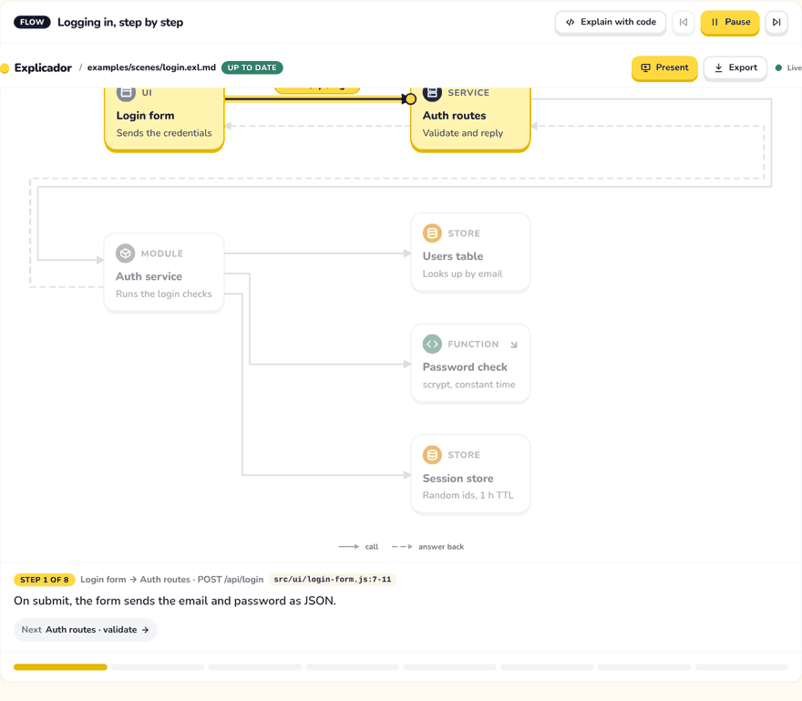
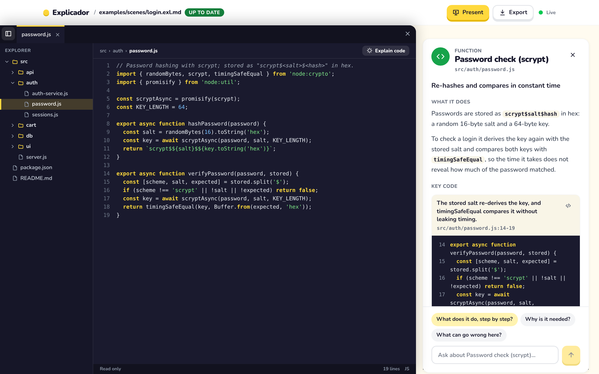
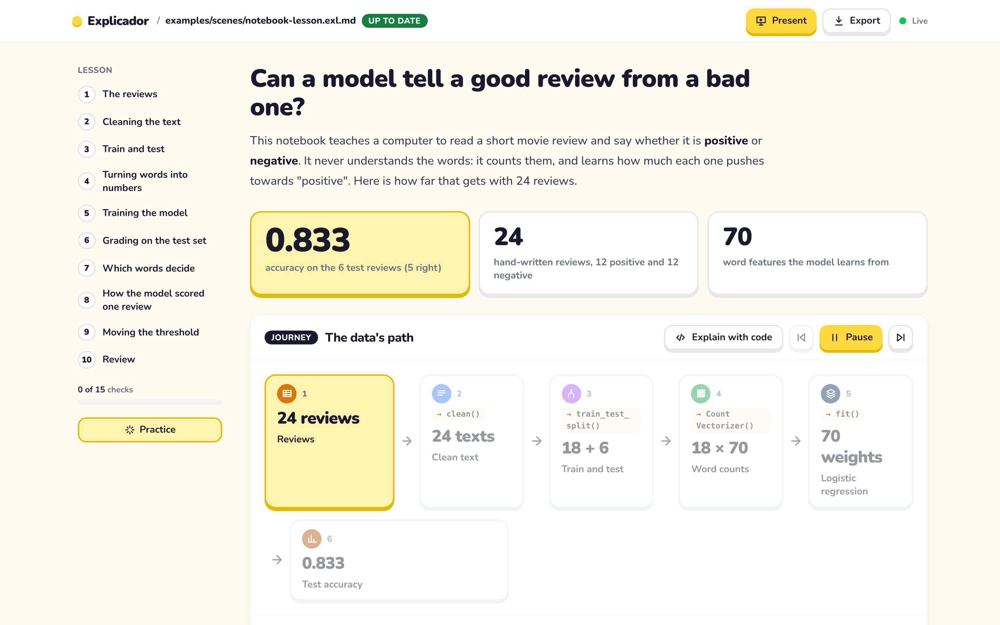
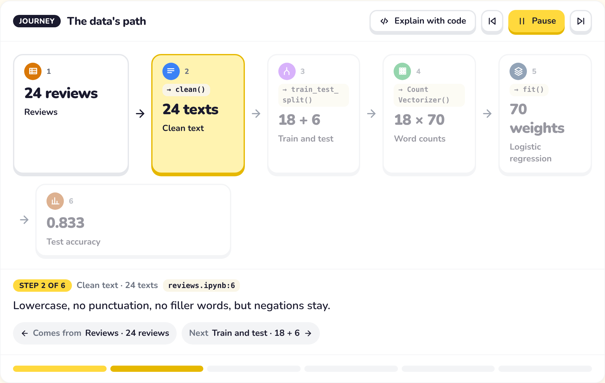
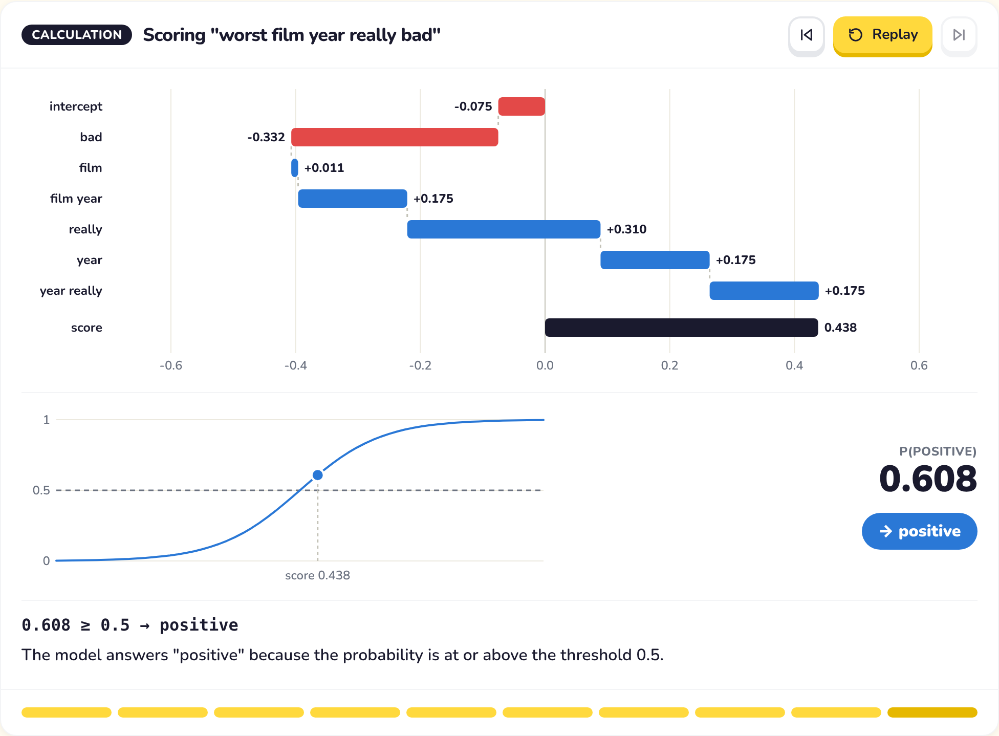
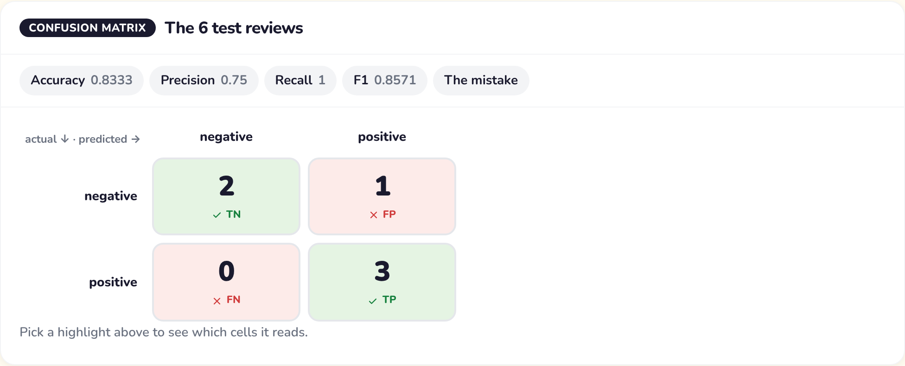
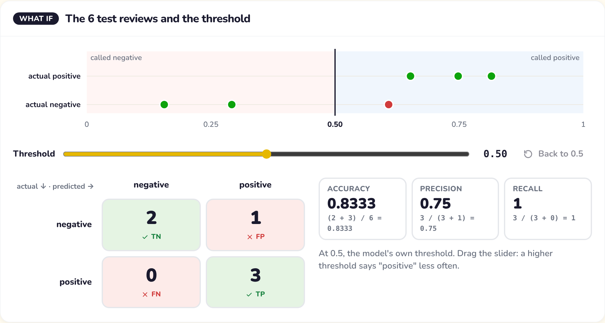
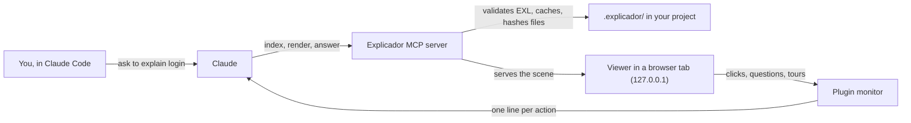

<div align="center">



# Explicador

**Understand any codebase, one animated scene at a time.**

Explicador is a Claude Code plugin. Ask how something works and Claude answers in a few sentences, then shows the answer as diagrams that play in a local browser tab: the parts involved, the steps of a request, the data model and, for notebooks, a lesson built on the real numbers.


[Features](#features) · [Quick start](#quick-start) · [Ask Claude](#ask-claude) · [How it works](#how-it-works) · [Notebook lessons](#notebook-lessons) · [Limits](#limits-and-roadmap)

</div>

## Why it exists

Reading an unfamiliar codebase means holding a dozen files in your head at once. Explicador draws them instead. It is built for developers getting onto a system and for teachers who want to present one step by step.

## Features

- 🧭 **Architecture at a glance.** The parts and how they connect, with groups you zoom into and a short description in every box.
- ▶️ **Flows that play.** Each step plays in order: a token travels along the call, returns come back dashed, async messages are dotted, and the narration explains every step.
- 🗂️ **Data models and state machines.** Entities with keys and cardinality, states with transitions, and an optional narrated walk.
- 🔎 **Click to go deeper.** A detail panel shows what a part does and its key code, copied from your files. Ask a question about any box, or go deeper.
- 🖥️ **A code window.** Read-only, with tabs and a file explorer. Claude can walk you through the code with a guided tour that highlights each part.
- 📓 **Notebook lessons.** Jupyter notebooks become chapters with the real data: the data's journey, one real example followed from raw input to prediction, charts, confusion matrices, worked calculations, formulas, a threshold you move, checks, flashcards and practice mode.
- 🎞️ **Present and export.** Turn a scene into full-screen slides for a speaker: the question as the cover, then one animated component per slide with its title as its one sentence, while the prose stays on the page. Or export it as one HTML file that opens offline.
- ⚡ **Cached and fresh.** Scenes are cached in your project. When a file a scene references changes, the scene is marked stale and refreshed on the next explanation.
- 🌍 **Any language.** There is no parser per language. Claude reads the code, so any language Claude can read works.

## See it

### Architecture and flows



<sub>The `login` scene for `examples/shop`: the parts of the login, with the auth core grouped.</sub>



<sub>The same login as a flow. Each call and return plays in order, and the narration links to the step before and after.</sub>

### Click anything



<sub>Clicking a box opens its panel: what it does and the key lines, copied from `src/auth/password.js`. The code window opens beside it, read-only, with the file tree.</sub>

## Quick start

Requirements: **Node 22.18+** (24 recommended) and **Claude Code**.

```sh
npm install
npm run build                 # builds the MCP server and the viewer
cd examples/shop
claude --plugin-dir ../..
```

Then, in Claude Code:

```
/explicador:explain login
```

The first run reads the project's index and the files on the login path, renders the scene and opens the viewer in your browser. Ask again with no changes and the cached scene appears without reading any code. Change a file the scene references and the next explanation refreshes it.

> Explicador runs from a checkout for now. Installing from a marketplace is not supported yet.

Want to see the viewer without Claude? Serve a scene file and it reloads on every save:

```sh
npm run preview -- examples/scenes/login.exl.md --project examples/shop
```

## Ask Claude

Explicador adds two skills to Claude Code (the `/explicador:explain` command and the guide that teaches Claude to write scenes) and eight tools.

Run `/explicador:explain <topic>` to explain a part of the project. Claude uses these tools behind it:

| Tool | What it does |
|---|---|
| `ensure_index` | Builds the light index (file tree and imports) in `.explicador/index/` |
| `show_scene` | Returns a cached scene if its files are unchanged, or lists what changed |
| `render_scene` | Validates a scene, caches it and shows it in the viewer |
| `answer_question` | Answers a question from a box's panel, with the lines that prove it |
| `explain_code` | Sends a guided code tour to the code window |
| `read_notebook` | Reads a notebook's cells and their outputs |
| `export_scene` | Writes a scene as one standalone HTML file |
| `add_finding` | Appends a finding to `FINDINGS.md` |

Claude writes scenes in **EXL**, a closed catalog of tags. There is no JavaScript and no raw HTML, and the server rejects anything outside the catalog before it is shown.

| Tag | Shows |
|---|---|
| `<arch>` | Parts, groups and the connections between them |
| `<flow>` | Ordered steps, with calls, returns and async messages |
| `<data>` | Entities, fields, keys and relations |
| `<state>` | States, transitions and an optional walk |
| `<chapter>`, `<stats>`, `<journey>`, `<trace>`, `<chart>`, `<matrix>`, `<calc>`, `<threshold>`, `<quiz>` | Lessons: chapters, numbers, data paths, one example changing form step by step, charts, matrices, calculations, thresholds and checks |
| `<concept>`, `<plot>`, `<derive>`, `<scatter>`, `<compare>`, `<timeline>`, `<theme>` | Concept cards, functions with marks, formulas changed line by line, classes and their boundary, comparisons, events in order, and the scene's decoration |
| `<space>`, `<cosine>`, `<value kind="vector">`, `<chapter stage>` | Vector spaces with their index, angles and nearest items, the cosine worked out step by step, embeddings as vectors, and a map of the whole process at each chapter |
| `<structure>` | A tree, an organization chart or a file tree drawn as itself, changing state by state: members glide to their new places |
| `<brief>`, `arc` | Nothing: the plan every scene opens with (audience, question, one example, the misconception, the check, the terms) and each component's part of the narrative. The server refuses a scene without a brief and checks the order: the example before any rule or answer, the misconception corrected on a slide, terms and acronyms defined before use, a check at the end |

The full format is in [`docs/EXL.md`](docs/EXL.md).

## Deep dives

To understand a whole process, the scene becomes a deep dive: a map of the process, then one chapter per stop, each opening with the map and its stop lit, each with its own picture, and the same real example all the way through. In Present mode each part's narration shows as a subtitle (S turns it off). `examples/rag` is a small retrieval pipeline (embed, store, index, search, score) whose `npm run demo` prints every number of `examples/scenes/rag.exl.md`:

```bash
npm run preview -- examples/scenes/rag.exl.md --project examples/rag
```

## Notebook lessons

Explicador can explain a notebook as a lesson, not only as a diagram. Each section becomes a chapter with its real cells and outputs, the numbers on screen come from those outputs, and the viewer computes the metrics itself.



<sub>The lesson for `examples/notebook/reviews.ipynb`: headline numbers, the data's journey and a rail that tracks progress through the chapters and checks.</sub>

<table>
  <tr>
    <td width="50%"><br><sub>The data's journey, step by step, with the real sizes.</sub></td>
    <td width="50%"><br><sub>A worked calculation: the score, the sigmoid and the decision.</sub></td>
  </tr>
  <tr>
    <td width="50%"><br><sub>A confusion matrix; the metrics come from its counts.</sub></td>
    <td width="50%"><br><sub>Move the threshold and the matrix and metrics recompute.</sub></td>
  </tr>
</table>

Each chapter ends with checks, the final review is a set of flashcards, and **Practice** asks every check again, missed ones first. Progress is kept in the browser. The guide asks Claude to take every number from a notebook output or from a computation that actually ran.

## How it works



- Claude reads the project through a light index and opens only the files it needs.
- Every scene is validated before anything is cached or shown. The files it references must exist, and their hashes decide when the scene is stale.
- The server copies key code from your files when it shows a scene, so the code on screen is never typed by the model.
- The viewer is a React app; diagrams are SVG, laid out with ELK.js. It runs on a local bridge bound to `127.0.0.1`, with a per-launch token and origin checks.
- Clicks and questions reach Claude through a plugin monitor, so Explicador needs no special launch flags.

### Your project stays yours

Explicador keeps its state in the project you analyze:

- `.explicador/index/`: the file tree and imports
- `.explicador/scenes/`: cached scenes, with their questions and answers
- `.explicador/exports/`: standalone HTML exports
- `FINDINGS.md`: findings you can keep, appended by `add_finding`

The code window only reads files inside the project. Hidden files and folders such as `.env` or `.git` are never served, and neither are files reached through symbolic links that leave the project.

## Limits and roadmap

**Limits today**

- Questions, "Go deeper" and code tours need an interactive Claude Code session. Plugin monitors do not run under `claude -p`.
- Exported files are read-only: no "Go deeper" and no questions.
- Notebook cells are shown, not run yet.
- Browser tests run in Chromium, Firefox and WebKit in CI; only Chromium has been run on a real Windows machine.
- The viewer's interface is in English for now.
- Explanations are only as good as the code Claude reads. The detail panel shows each box's file and key lines, so you can check them.

**Roadmap**

- Run notebook cells from the viewer with a Jupyter kernel and a time limit (planned).
- Install from a marketplace.
- Decide the viewer's interface language.

## Develop

```sh
npm run typecheck
npm run lint
npm run build                 # run before npm test and the browser tests: both need the built viewer
npm test
npm run e2e                   # browser tests in Chromium (npm run e2e:all adds Firefox and WebKit)
npm run eval:comprension -- --dry   # comprehension bench: what it would ask and what it would cost (no model call)
```

CI (`.github/workflows/ci.yml`) runs typecheck, lint, build and test on Ubuntu, Windows and macOS, and the browser tests in the three browsers, on every push. `npm run eval` measures the skill with `claude plugin eval` on Haiku, Sonnet and Opus; it spends model usage, so it is a local command and not part of CI. `npm run eval:comprension` measures whether a scene makes a small model (Haiku) understand a topic of the bench in `evals/bench/` (ten topics, see [`docs/baseline-f22.md`](docs/baseline-f22.md)); its `--dry` and `--print` options call nothing, and [`docs/prueba-humana.md`](docs/prueba-humana.md) is the protocol for showing a scene to people.

```
.claude-plugin/    plugin manifest (the MCP server is declared here)
monitors/          click monitor that delivers clicks and questions to Claude
skills/            explicador (how to write scenes) and explain (/explicador:explain)
server/            MCP server, local bridge, EXL parser, cache, index, notebooks, exports
viewer/            React + Tailwind viewer; scenes laid out with ELK.js
examples/          sample projects (shop, rag), a notebook and sample scenes
docs/              EXL format and decision records
```

For development without Claude, `npm run dev -w server` and `npm run dev -w viewer` rebuild on change, and `EXPLICADOR_NO_BROWSER=1` stops the server from opening tabs. See [`docs/decisions/interactivity.md`](docs/decisions/interactivity.md) for how clicks reach Claude.

## Credits

The viewer uses the [Nunito](https://fonts.google.com/specimen/Nunito) typeface under the SIL Open Font License (`viewer/src/assets/fonts/OFL.txt`).

## License

No license has been chosen yet. Ask the author before reusing the code.
