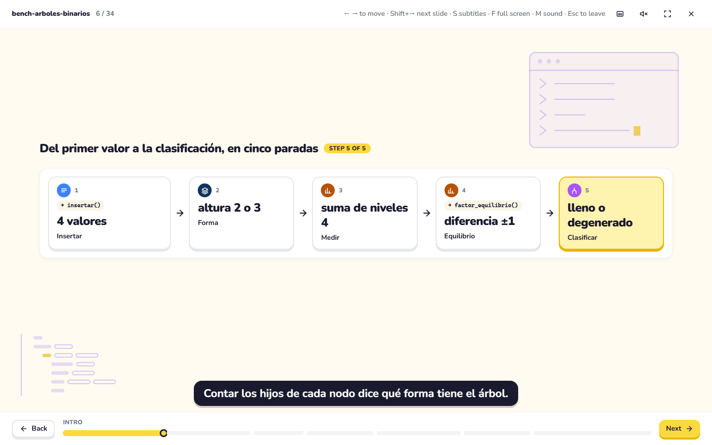
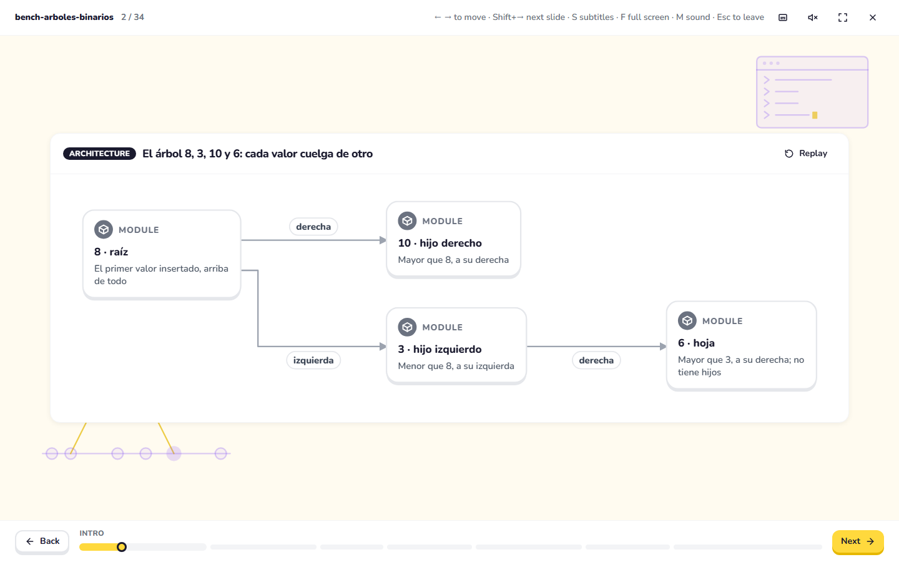
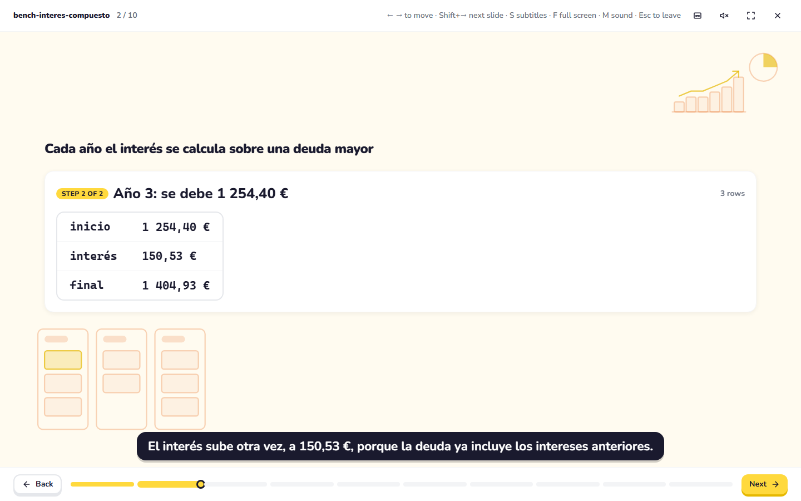
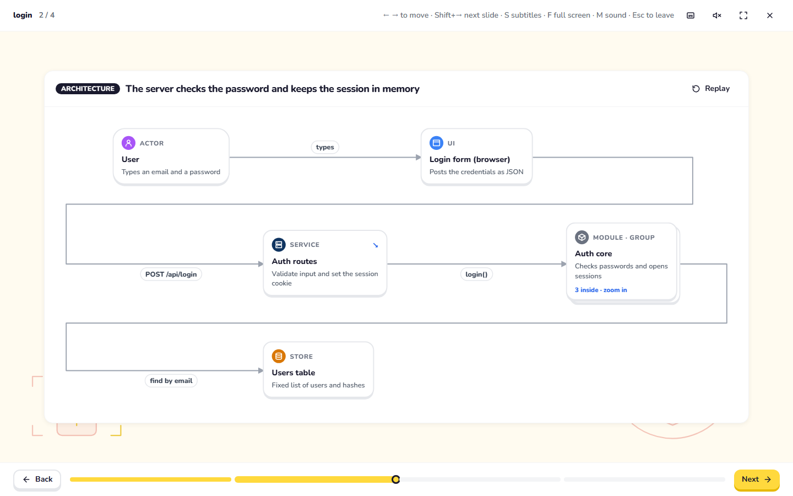

# Baseline of F22: ten topics, today's rules and comprehension

Measured on 2026-11-13 with `npm run eval:comprension -- --runs 1` on Haiku 5.5 (20 calls, $0.012 at list price). Raw answers: `evals/results/comprehension-2026-11-13T22-23-01-708Z/` (not in git). One run per condition, so a cell moves by a whole question between runs: read the table for orders of magnitude, not decimals.

## The table

| Topic | Kind | Components | Rule warnings | Without the scene | With the scene | Gain |
|---|---|---|---|---|---|---|
| arboles-binarios | algorithm | 17 | 0 | 2 / 5 | 5 / 5 | +3 |
| login-tienda | architecture | 3 | 0 | 4 / 5 ⚠ | 5 / 5 | +1 |
| regresion-resenas | notebook | 22 | 0 | 2 / 5 | 5 / 5 | +3 |
| interes-compuesto | personal finance | 8 | 0 | 1 / 5 | 5 / 5 | +4 |
| fotosintesis | science | 6 | 0 | 2 / 5 | 5 / 5 | +3 |
| ley-aprobacion | institutions | 5 | 0 | 4 / 5 ⚠ | 5 / 5 | +1 |
| contrato-alquiler | document | 5 | 0 | 2 / 5 | 4 / 5 | +2 |
| embudo-ventas | business | 7 | 0 | 0 / 5 | 5 / 5 | +5 |
| imprenta | history | 5 | 0 | 5 / 5 ⚠ | 5 / 5 | +0 |
| pan | everyday | 6 | 0 | 2 / 5 | 5 / 5 | +3 |
| **Mean** | | 8.4 | 0 | **2.4 / 5** | **4.9 / 5** | **+2.5** |

⚠ = Haiku gets 4 or more right without the scene, so those questions can be answered from general knowledge and the gain says little. The eval marks them itself.

"Rule warnings" is what `render_scene` would list with today's rules (`sceneWarnings`). **All ten scenes have zero**, which is the problem this plan starts from: every scene is valid and the rules cannot tell a good one from a bad one. The rules of F24 will be added as a column here.

## What the numbers say

1. **The model eval measures content, not clarity.** With the scene, Haiku answers 4.9 of 5: any text that holds the facts gets a full score, whatever order, picture or hierarchy it has. The one miss is real and useful: `contrato-alquiler` omits the 5 % cap on the renewal rent (clause 10), so the question about it cannot be answered from the scene (Haiku said 450). The eval catches **omissions and ambiguities**, and cannot catch a map that hides the question behind the result, a term used before it is defined, decoration over the content or three counters at once. Those are what the human protocol (`docs/prueba-humana.md`) is for, and what the rules of F24 will check. This is the main limit of the baseline and the reason F30 needs people, not only the model.
2. **The first version of the questions was saturated and was thrown away.** Questions that apply general knowledge to numbers in the question itself (compound interest of 2 000 € at 10 %, "which gas makes bread rise") got 4.6 of 5 without any scene (4.9 with it): no gain to measure. The 50 questions now hinge on what only each explanation says (its example, its rules, its numbers), and the no-scene score fell to 2.4. Three topics still sit at 4–5 without the scene (`imprenta`, `ley-aprobacion`, `login-tienda`): a model knows how a press, a parliament or a session cookie works. They keep their questions for now and are marked; F30 should rewrite them around the explanation's own details if the gain stays flat.
3. **Where the scene adds the most is where the facts are the explanation's own**: the funnel's numbers (+5), the compound-interest example (+4), the tree's example and conventions, the notebook's outputs and the photosynthesis example (+3 each).

## The three representative scenes

Screenshots of Present at 1440 × 900 with reduced motion, made with `EXPLICADOR_CAPTURE=docs/images/f22 npm run e2e -- e2e/capture.spec.ts`.

### Trees (the case that started the plan)

The map slide (slide 6 of 34 in this scene):



- No tree is drawn on the map, and the scene's one tree (slide 2) is a box-and-arrow diagram laid out left to right, not a tree:



- Each box leads with its result ("4 valores", "altura 2 o 3", "lleno o degenerado") in large type and puts the verb ("Insertar", "Forma", "Clasificar") below in small type: the hierarchy is inverted.
- "altura 2 o 3" does not say edges or levels; "LCI" and "FE" have not been defined at this point.
- Five icon colors with no meaning (blue, navy, two oranges, purple), `insertar()` and `factor_equilibrio()` chips on 2 of 5 boxes, and three progress counters at once: "6 / 34" in the header, "STEP 5 OF 5" next to the title and the progress bar below.

### Compound interest (not technical)



- The idea (the debt grows faster each year) is in the title and the subtitle, but the table shows one year at a time, so the change between years is never on screen together. The scene says it; the picture does not show it.
- A decoration of three columns sits under the table and "STEP 2 OF 2" repeats the progress bar.

### Login (technical)



- The decoration at the bottom left and bottom right runs behind the diagram and is cut by it; the long routed edges (`find by email`, `POST /api/login`) go around the whole slide.
- Five box kinds in five icon colors (purple, blue, navy, gray, orange) with no stated meaning, and the diagram shows who talks to whom but not what travels or what changes; the trace and the flow that do show it come later.

## How to reproduce

```sh
npm run build
npm run eval:comprension -- --dry                 # what would be asked and an estimated cost, no model call
npm run eval:comprension -- --runs 3              # Haiku only; costs usage: tell the user first
npm run eval:comprension -- --print --topics pan  # the questions as a person reads them, for the human protocol
```

Only Haiku runs by default; any other model needs `--allow-other-models` and the user's go-ahead (`docs/plan.md`, "Eval budget").
