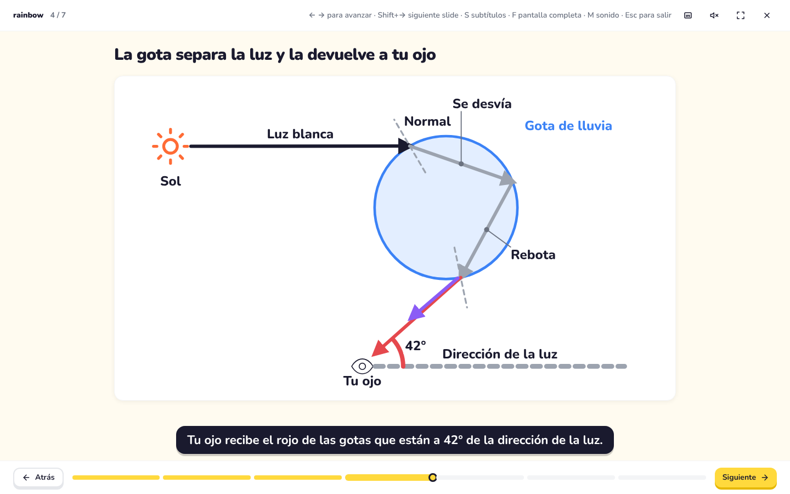
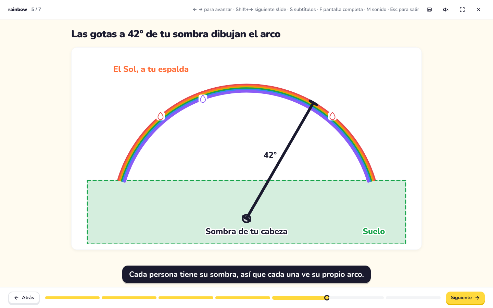
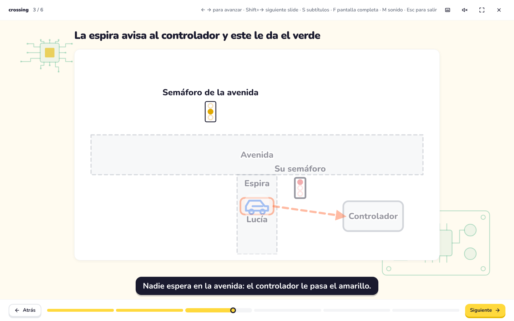
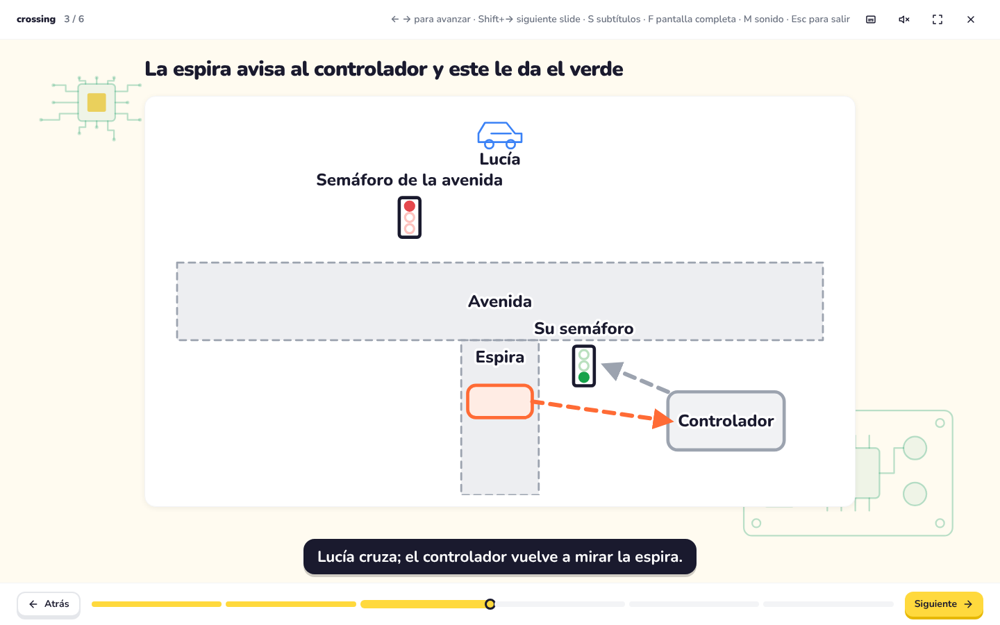

# What makes a figure explain: real figures against ours (F32–F35)

Asked by the user on 2026-11-14: `<figure>` is to become the main component to explain a topic, and its drawings must really help the explanation, compared with real explanatory figures. The comparison below comes from web searches of 2026-11-14 (the session could not open the pages themselves, only their search summaries), the research on learning from pictures, and the two topics of the Sonnet/Opus test.

## What the real figures of the two topics draw

**The rainbow** (weather services, physics textbooks, Descartes' 1637 diagram):

1. One drop, large, with the ray entering, bending, reflecting off the back and leaving, and **the normal drawn at each surface** (an angle measured against a horizontal line gives the wrong direction).
2. **The Sun behind the observer** and **the observer's eye**, with the line from the Sun through the eye to the **antisolar point**: the 42° is measured from that line.
3. **Several drops at different heights, each sending one color to the eye**: red comes from the higher drops (42°), violet from the lower ones (40°). This is what puts red on the outside of the bow; one drop alone does not explain the order of the colors.
4. **The bow as a circle of 42° around the antisolar point**, red outside and violet inside, often with the secondary bow at about 51° with its colors reversed.

**The actuated traffic light** (FHWA, state DOT manuals, engineering courses):

1. **A plan view of the crossing**: the roads, the stop lines, the signal heads, and **the detector loop drawn in the lane**, with its cable to **the controller cabinet**.
2. A vehicle over the loop sends **a call** (a demand for green) to the controller.
3. **A time diagram of the phases**: the green is extended by a passage time each time a vehicle crosses the detector, up to a maximum.

## What the research on learning from pictures says

- **Congruence** (Tversky, Morrison and Bétrancourt, 2002): an animation helps when what moves on screen is what moves in reality; otherwise a sequence of static frames is as good or better, and for mechanical systems a static diagram can beat an animation (Mayer, Hegarty and Campbell, 2005).
- **Segmenting**: the learner sets the pace, one step at a time (Mayer).
- **Signaling or cueing**: cues select what to look at, organize it and integrate it; dimming what is not the point of the step is one such cue (Mayer; Kühl, Scheiter and Gerjets).
- **Spatial contiguity**: each word next to the part it names, not in a legend; when a label must sit away, a straight **leader line** ending in a small dot; leaders do not cross and labels do not overlap (Mayer; surveys of external labeling; medical illustration guides).

## Our figures against them

| Convention | F31 rainbow | Opus traffic light (test) | Phase that adds it |
|---|---|---|---|
| The thing drawn as itself | a drop and rays | boxes "UI", "SERVICE" | F31 (`<figure>`, everyday kinds) |
| What changes, changes on screen (a light turns green, a car crosses, a call travels) | nothing moves | nothing moves | **F32** movement and states (done: `examples/scenes/crossing.exl.md`) |
| Geometry that is true (normals, rays that touch the drop, angles measured from the right line) | coordinates by hand, no normals | — | **F33** anchors and checks (done: the rainbow on true optics, with normals) |
| Recognizable objects (Sun, eye, car, signal head) and the bow as an arc, a measured distance | circles | — | **F34** pictograms, arcs, measures (done: the Sun, the eye, the car, signal heads, the bow as arcs) |
| Labels next to their parts, leaders when far, the step's parts lit and the rest dimmed | labels avoid each other only | — | **F35** clearer reading (done: labels clear of lines and shapes, leaders, dimming, descriptions on a click) |
| Several drops, each sending one color | one drop sends both | — | the rebuilt examples (F32–F35); F34 adds the bow with drops on its red and violet arcs |
| The final frame complete, readable as a static diagram | yes | — | kept in every phase |

## Our figures after F32–F35

The two topics again, with the conventions of the real figures. The rainbow's single drop follows a ray on true optics (water 1.331 for red, the ray of least deviation) from the Sun behind the observer, with the normals at entry and exit, to the eye at 42.4° from the direction of the light; the second figure draws the bow as a circle around the shadow of the observer's head, red outside, with the drops at 42° sending red and those at 40° sending violet. The crossing is a plan view with the loop in the lane, the controller's cabinet and the signal heads; the car stops on the loop, its call travels to the controller, the reader predicts, and the lights change.

| | |
|---|---|
|  |  |
|  |  |

What is still missing against the real figures: the time diagram of the signal's phases (green extended by each car), which is a chart rather than a drawing; drawings in perspective; and pictograms seen from above for plan views.

## Sources

- [National Weather Service: Rainbow](https://www.weather.gov/fgz/Rainbow), [Wikipedia: Rainbow](https://en.wikipedia.org/wiki/Rainbow), [Fox Weather: how a rainbow forms](https://www.foxweather.com/learn/how-does-a-rainbow-form), [RevisionDojo: why a rainbow forms](https://www.revisiondojo.com/blog/why-does-a-rainbow-form-after-rain), [Western Washington University: rainbows](https://astro101.wwu.edu/a101_rainbows.html), [University of Rochester lecture](https://www.pas.rochester.edu/~dmw/phy218/Lectures/Lect_73b.pdf), [Astronomy: how to read rainbows](https://www.astronomy.com/science/how-to-read-rainbows/)
- [FHWA: actuated signal operation](https://www.fhwa.dot.gov/publications/research/operations/its/06108/04.cfm), [Wisconsin DOT: loop detectors](https://wisconsindot.gov:443/dtsdManuals/traffic-ops/manuals-and-standards/tsdm/08/08-01-02.pdf), [USC Illumin: traffic-actuated signals](https://illumin.usc.edu/traffic-actuated-signals/), [CED Engineering: detection for traffic signals](https://www.cedengineering.com/userfiles/Detection%20For%20Traffic%20Signals%20R1.pdf)
- [Mayer, multimedia principles (2020)](https://ugc.futurelearn.com/uploads/files/7d/d6/7dd6188d-c343-4311-b064-ac98d2c95abc/Multimedia_Principles._R._E._Mayer__2020.pdf), [review of the principles (PMC)](https://pmc.ncbi.nlm.nih.gov/articles/PMC7940870), [cueing in dynamic and static visualizations (Mannheim)](https://madoc.bib.uni-mannheim.de/38176/), [Tversky et al. and dynamic visualizations (Springer)](https://link.springer.com/content/pdf/10.1007/s10648-009-9098-7.pdf)
- [External labeling: a taxonomy and survey](https://arxiv.org/pdf/1902.01454), [labels and arrows in medical illustrations (EMWA)](https://journal.emwa.org/visual-communications/get-your-visual-act-together-optimising-the-design-of-labels-and-arrows-in-medical-illustrations/article/5492/get-your-visual-act-together.pdf), [Nature Methods: labels and callouts](https://www.nature.com/articles/nmeth.1676)
- [Bartosz Ciechanowski: Mechanical Watch](https://ciechanow.ski/mechanical-watch/), an example of figures built part by part next to the text that explains them.
