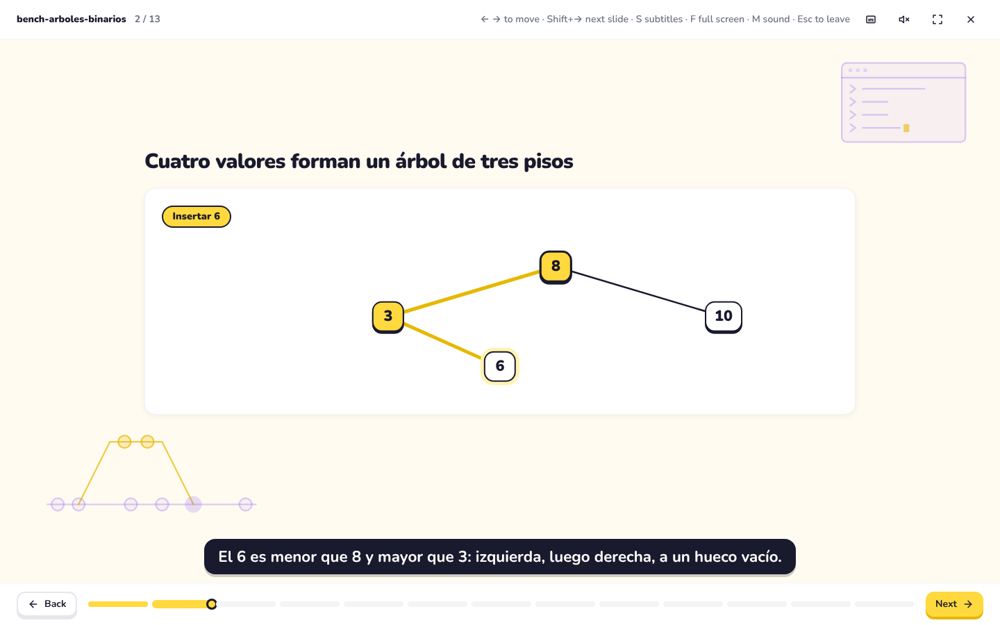
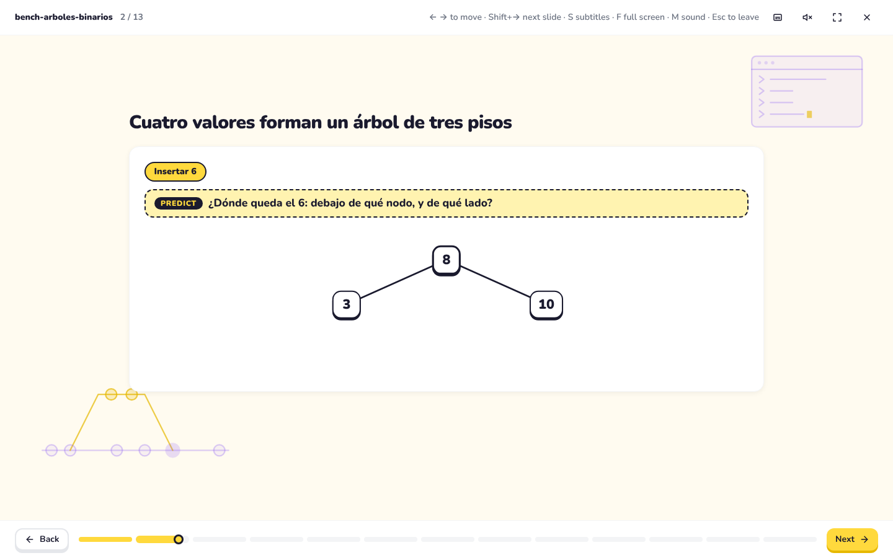
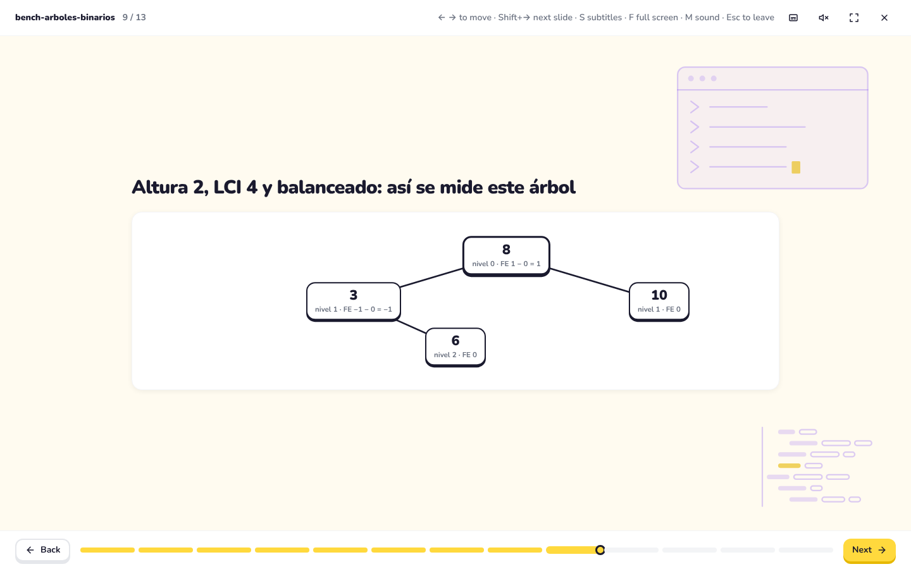

# Results of F23–F30: the same bench, measured again

Measured on 2026-11-14 with `npm run eval:comprension -- --runs 1` on Haiku 5.5 (20 calls, $0.015 at list price, run with the user's go-ahead). Raw answers: `evals/results/comprehension-2026-11-14T02-52-33-636Z/` (not in git). One run per condition, like the baseline, so a cell moves by a whole question between runs.

## The table, before and after

| Topic | Warnings F22 → now | Without the scene | With the scene, F22 → now | Gain, F22 → now |
|---|---|---|---|---|
| arboles-binarios | 1 → 0 | 3 / 5 | 5 → 5 | +3 → +2 |
| login-tienda ⚠ | 0 → 0 | 4 / 5 | 5 → 5 | +1 → +1 |
| regresion-resenas | 0 → 0 | 2 / 5 | 5 → 5 | +3 → +3 |
| interes-compuesto | 1 → 0 | 0 / 5 | 5 → 5 | +4 → +5 |
| fotosintesis | 2 → 0 | 2 / 5 | 5 → 5 | +3 → +3 |
| ley-aprobacion ⚠ | 1 → 0 | 4 / 5 | 5 → 5 | +1 → +1 |
| contrato-alquiler | 1 → 0 | 2 / 5 | **4 → 5** | +2 → +3 |
| embudo-ventas | 1 → 0 | 0 / 5 | 5 → 5 | +5 → +5 |
| imprenta ⚠ | 2 → 0 | 5 / 5 | 5 → 5 | +0 → +0 |
| pan | 1 → 0 | 2 / 5 | 5 → 5 | +3 → +3 |
| **Mean** | 1.0 → 0 | 2.4 / 5 (both) | **4.9 → 5.0** | **+2.5 → +2.6** |

"Warnings F22" is the count with the rules of F23 and F24 on the F22 scenes (`docs/baseline-f22.md`); "now" is every rule up to F30. "Without the scene" is the same condition in both runs and moved by one question in two topics (trees 2 → 3, interest 1 → 0), which is the noise of one run. ⚠ as in the baseline: answerable from general knowledge.

## What the numbers say, and what they cannot

1. **Every scene now holds what its questions ask.** With the scene, Haiku answers 5 of 5 in all ten topics. The one miss of F22 is gone: the lease scene now reads every clause note by note, the 5 % cap at renewal included.
2. **The model eval cannot see the rest of what changed.** As the baseline found, a text with the facts scores 5 of 5 whatever its order, picture or hierarchy. The scenes now open with the case before any rule, define every term and acronym before using it, correct the topic's frequent error on a slide of its own, draw the tree as a tree and the lease as a lease, and end on a prediction. None of that moves a score that was already at the ceiling. Measuring it needs people: the protocol in [`prueba-humana.md`](prueba-humana.md), with three readers per scene, has not been run.
3. **The rules can now tell a good scene from a bad one.** In F22 all ten scenes had zero warnings, which was the problem the plan started from. With the rules of F23–F29 the old scenes get 1 or 2 each, and the rebuilt ones none; the rules check what the principles ask (a brief, the order of the arc, terms before use, the form drawn), not only the format.
4. **Three topics still say little** (⚠): a model knows how a parliament, a printing press and a session cookie work. Their questions should be rewritten around what only each explanation says before they are used to compare scenes.

## The scene that started the plan

The trees scene of F22 opened with a map of five boxes that led with their results, used "LCI" and "FE" before defining them, and drew its one tree as a box diagram. Now it opens with the tree growing value by value, asks where the 6 goes before showing it, defines each term on a card, and measures the tree on the tree itself:







The slide of measures was changed after the run, from a trace of four tables to the tree with each node's level and balance factor under it (and the height, LCI and mean in a `<stats>`); the facts are the same, and the scene was not measured again.

## Limits of this measurement

- **Who wrote the scenes.** The session's model rebuilt the eight scenes from each topic's `source.md`, without opening the questions, but it also wrote the rules they follow, so the scenes are a best case of what the skill can produce, not what a model following it produces unaided. The next measurement should let Haiku, Sonnet and Opus write the scenes with `npm run eval` (each run costs usage, so with the user's go-ahead).
- **One run.** The user chose one run; three would average out a question either way.
- **No people yet.** The protocol is ready; it has not been run.

## How to reproduce

```sh
npm run build
npm run eval:comprension -- --runs 1   # Haiku only; costs usage: tell the user first
EXPLICADOR_CAPTURE=docs/images/f30 npm run e2e -- e2e/capture.spec.ts -g arboles
```
